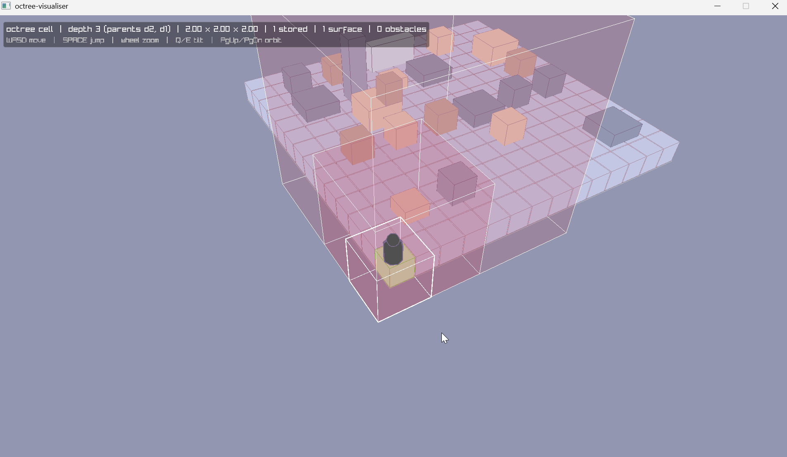

# octree-visualiser

A C++ octree for 3D spatial partitioning, with live raylib visualisation of node subdivision, collision queries, and a player moving through the tree.

## Overview

Four main components:

| File | Purpose |
|---|---|
| `src/collision detection/AABB.h` | Axis-aligned bounding box in 3D, plus `contains` and `intersects` |
| `src/collision detection/Octree.{h,cpp}` | The octree: insert, query, remove, clear |
| `src/collision detection/CollisionWorld.{h,cpp}` | Wraps the octree for the level's static colliders |
| `src/visualiser/OctreeVisualiser.{h,cpp}` | Draws the active octree node and its contents around the player |

This project reuses the core logic of the [quadtree-visualiser](https://github.com/buggycww/quadtree-visualiser). Technical and design changes were made where necessary to properly convert it from 2D to 3D; essentially, the difference between quadtrees and octrees.

- **2D → 3D.** `AABB` is now a 3D box, and each node splits into eight children instead of four.
- **Points → boxes.** Entries are full `AABB`s rather than single points. A box is stored in the deepest node that fully contains it; straddling boxes stay in the parent.
- **Ownership via ids.** The tree stores `uint32_t` ids rather than `Point*`. `CollisionWorld` maps an id back to its owning object, so the octree stays a pure spatial index.

## Visualizer

The window shows the octree node that contains the obstacles that the player is actively intersecting with. The window, camera and drawing are all done using raylib, instead of SFML like [quadtree-visualiser](https://github.com/buggycww/quadtree-visualiser). 

- **WASD** — move the player
- **Space** — jump
- **Page Up / Page Down** — orbit the camera left / right
- **Q / E** — tilt the camera down / up
- **Mouse wheel** — zoom the orbit camera in / out

The visualiser resolves the deepest node that contains the player's position (measured from the foot position) and draws its bounds, along with all ancestor bounds (except the root). Only the active node's entries are highlighted. Straddling boxes stay in their parents by design, so those entries are still drawn on the ancestor bounds.

Only nodes that contain entries, or are ancestors of such a node, are relevant to the current view. When a node exceeds its capacity, it subdivides into eight children and redistributes its entries.

## Build

Requires **CMake 3.24+** and a C++20 compiler. raylib 6.x is fetched automatically on the first configure if it is not already installed.

Configure and build:

    cmake -B build
    cmake --build build

Run:

    ./build/octree-visualiser

If raylib is already available via vcpkg or a system install, CMake will use it. Otherwise it downloads and builds the pinned release (6.2) from GitHub.

## Design Notes

**Boxes instead of points.** Unlike a quadtree of points, each entry stores its full `AABB`. A box is stored exactly once, in the deepest node that fully contains it. Boxes that straddle a split stay in the parent node. A query tests the entries of every visited node, so straddling boxes are still found.

**Half-open intervals.** `AABB::contains` uses `[x, x+w)` on all three axes. Points on the minimum face are inside, points on the maximum face are outside. This ensures every box falls into exactly one child when it fits entirely within an octant, so internal nodes remain consistent and query never sees duplicates.

**No merging on removal.** Similarly to the quadtree, when a node's entry count drops, its parent is not collapsed back into a single leaf. This is a design choice to avoid added complexity for merging.

**Ownership of ids.** The tree stores `uint32_t` ids, not object pointers. The id is only an identity/handle; `CollisionWorld` maps it back to the owning `GameObject` without the tree knowing about game types. This keeps the octree a pure spatial index.

**Query pruning.** `queryHelper` returns immediately if a node's bounds don't intersect the query range. Each comparison skips an entire subtree, which is why octrees are so fast.
